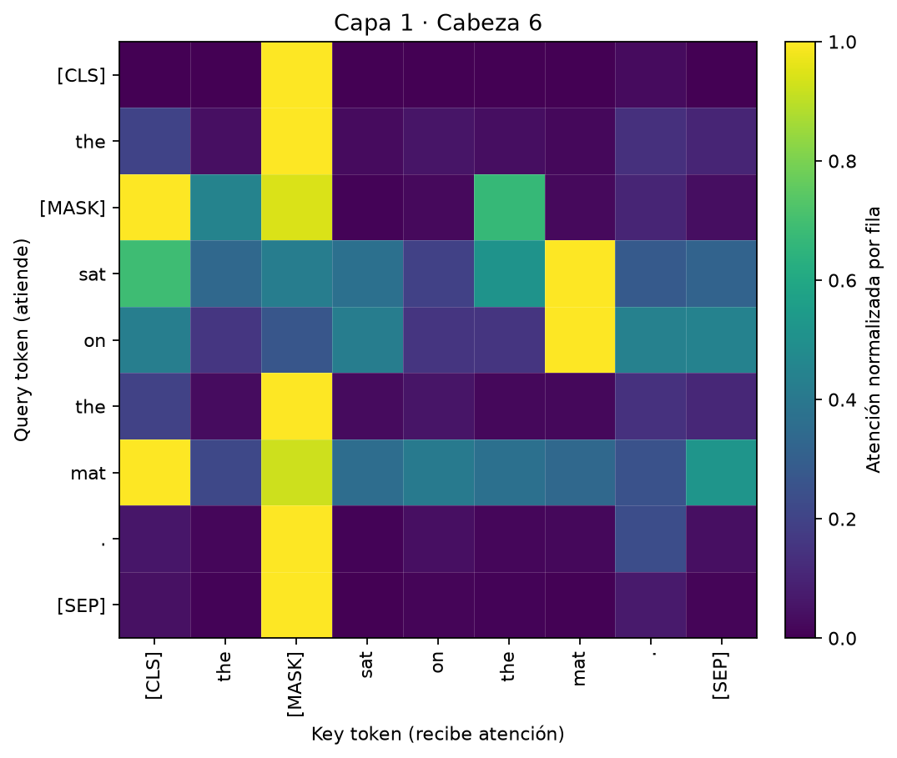
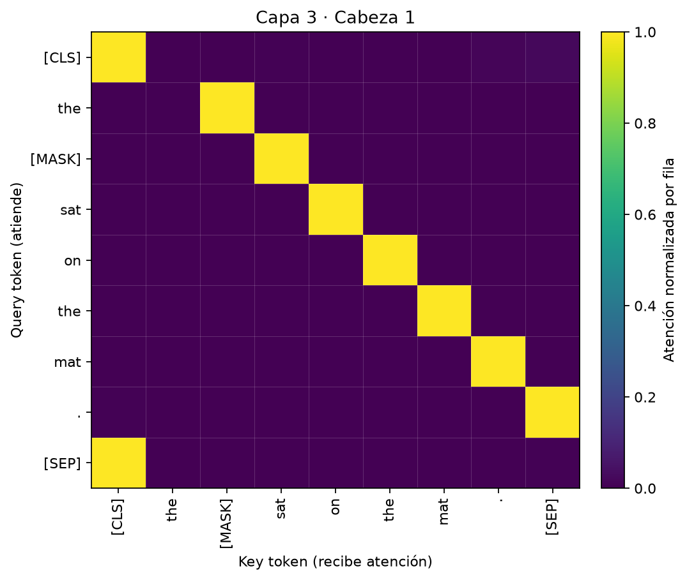
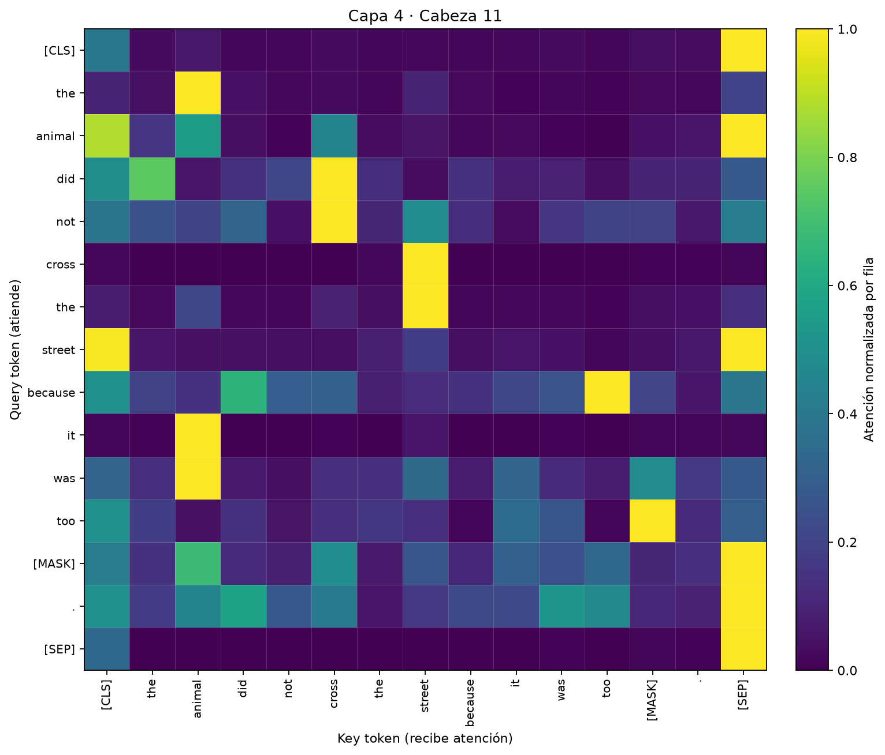
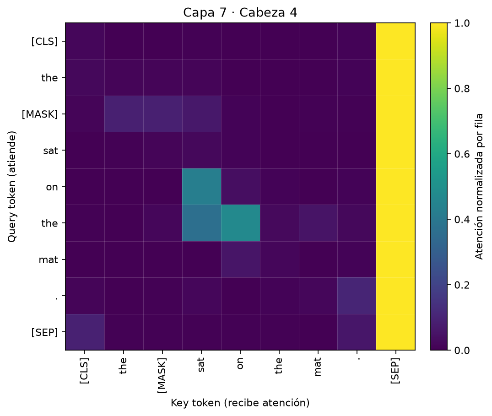
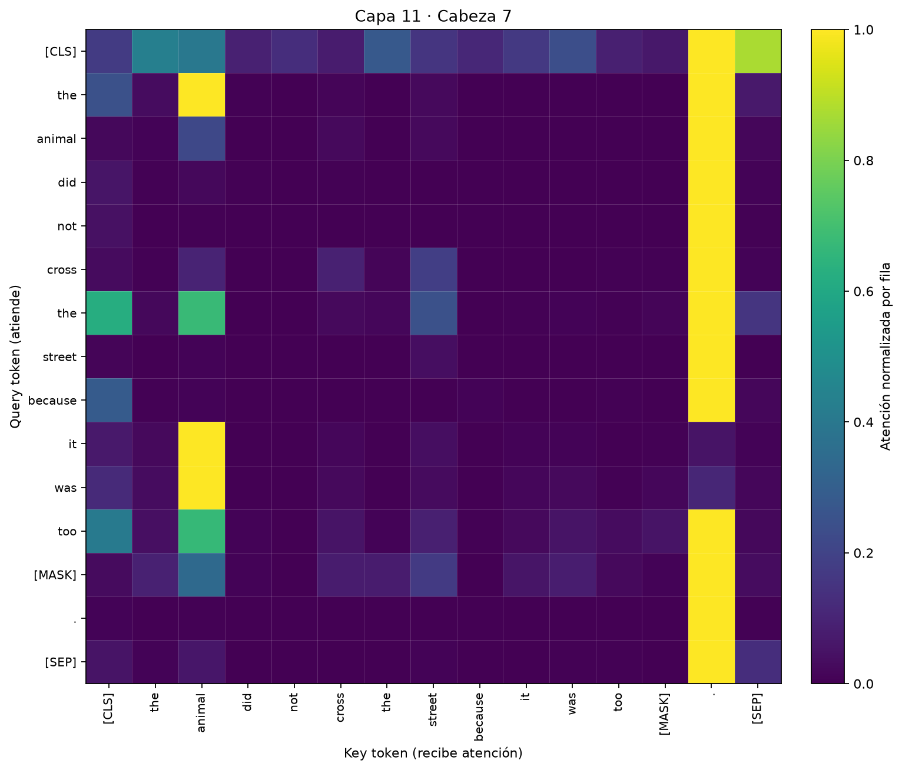

# Análisis de atención de BERT

Este documento interpreta los mapas generados por `scripts/analyze_attention.py` para tres
frases. No es una explicación causal del modelo: es un análisis descriptivo de qué tokens
reciben atención en cada capa y cabeza, con los pesos originales verificables en
[`results/analysis.json`](results/analysis.json).

## 1. Configuración

- Modelo: `bert-base-uncased` (12 capas, 12 cabezas, 110 M de parámetros).
- Tarea: *masked language modeling*; cada frase contiene exactamente un `[MASK]`.
- Tokenizador: WordPiece en minúsculas; los tokens especiales son `[CLS]`, `[SEP]` y
  `[MASK]`.
- Matriz por capa/cabeza: `(secuencia, secuencia)`. La fila es el **query** (el token que
  atiende) y la columna es la **key** (el token que recibe atención).
- Cada fila de la softmax suma 1.
- Las figuras están **normalizadas por fila** para que la relación dominante sea visible.
  Los pesos que se citan en el texto son los originales, no los normalizados.

Se generan 144 mapas por frase (12 × 12) con `src/mask.py`. En el análisis se revisaron
los 144 de cada frase y se guardaron ocho mapas representativos. La selección es
exploratoria y post hoc, no una prueba de hipótesis.

## 2. Predicciones

| Frase | Top-1 | Top-2 | Top-3 |
| :--- | :--- | :--- | :--- |
| `The [MASK] sat on the mat.` | girl (0,069) | man (0,067) | dog (0,057) |
| `The animal did not cross the street because it was too [MASK].` | late (0,120) | fast (0,113) | close (0,099) |
| `I learned a lot from this [MASK] artificial intelligence course.` | particular (0,081) | whole (0,064) | basic (0,039) |

Las probabilidades son moderadas o bajas. BERT no está entrenado para generar una respuesta
única: reparte masa entre continuaciones plausibles. Eso hace que la atención sea más
interesante que el top-1 aislado.

## 3. Patrones generales

### 3.1 Capas tempranas: contexto local y posición

Las primeras capas mezclan información de forma relativamente difusa. La entropía media es
alta: `1,59` en la capa 1 de la frase simple, `2,03` en la de correferencia y `1,87` en la
del curso. Algunas cabezas ya muestran patrones muy específicos.

En la capa 1, cabeza 6, de la frase simple, `[CLS]` atiende a `[MASK]` con `0,967` y
`[SEP]` atiende a `[MASK]` con `0,859`. Es una cabeza que concentra la atención en la
posición de la máscara, probablemente porque es el token que hay que predecir.



### 3.2 Capas 3: una cabeza de token siguiente

La capa 3, cabeza 1, es especialmente clara en las tres frases. En la frase simple:

- `the → [MASK] = 1,000`
- `[MASK] → sat = 0,9996`
- `sat → on = 0,9992`
- `on → the = 0,9999`
- `the → mat = 0,9999`

Es un patrón de **token siguiente**: cada posición mira la posición inmediatamente
posterior. En la frase de correferencia se repite: `it → was = 1,000`,
`was → too`, `too → [MASK]`, `[MASK] → .`. La cabeza 10 de la misma capa muestra un patrón
casi idéntico (`[MASK] → sat = 0,9994` en la frase simple).



Este hallazgo es interesante porque BERT es bidireccional, pero algunas cabezas aprenden
igual un comportamiento local de avance. No implica que toda la capa sea secuencial; es una
cabeza entre doce.

### 3.3 Capas medias y tardías: correferencia y selección

La frase de correferencia permite separar sintaxis local de dependencia semántica:

`The animal did not cross the street because it was too [MASK].`

La cabeza 4-11 conecta el pronombre con el antecedente:

- `it → animal = 0,854`
- `cross → street = 0,918`
- `the → animal = 0,601`
- `the → street = 0,562`



No es la única cabeza que lo hace. La capa 11, cabeza 7, da `it → animal = 0,803`, y la
capa 11, cabeza 9, `0,774`. La capa 5, cabeza 4, alcanza `0,703`. La correferencia no está
concentrada en una sola cabeza, sino distribuida en varias.

En la capa 7, cabeza 12, aparece una mezcla de sintaxis y selección léxica:

- `[MASK] → too = 0,948`
- `was → it = 0,831`
- `did → animal = 0,827`
- `not → did = 0,760`

La máscara mira al adverbio `too`, que restringe el tipo de adjetivo esperado
(`late`, `fast`, `close`, `slow`, `small`). Es una pista local, no una comprensión completa
de la frase.

### 3.4 Capas tardías: sumideros de atención

Una parte importante de las cabezas tardías no mira al contenido, sino a tokens
estructurales. En la frase simple, la capa 7, cabeza 4, envía casi todo a `[SEP]`:

- `[CLS] → [SEP] = 0,959`
- `sat → [SEP] = 0,943`
- `the → [SEP] = 0,931`
- `mat → [SEP] = 0,915`



En la frase de correferencia, la capa 11, cabeza 7, envía la mayoría de tokens al punto
final, pero conserva `it → animal = 0,803`:

- `. → . = 0,962`
- `street → . = 0,936`
- `not → . = 0,935`
- `did → . = 0,893`



Este comportamiento se conoce como **attention sink**: la cabeza usa un token frecuente o
estructural como “aparcamiento” cuando no necesita una relación semántica concreta. No debe
interpretarse como que el punto sea importante para la predicción. En la última capa, la
atención media de `[MASK]` al punto es `0,529` en la frase simple, `0,745` en la de
correferencia y `0,486` en la del curso; al `[SEP]`, `0,325`, `0,045` y `0,339`,
respectivamente.

### 3.5 La máscara y el contexto

En la frase del curso:

`I learned a lot from this [MASK] artificial intelligence course.`

La capa 8, cabeza 5, conecta la máscara con el determinante:

- `[MASK] → this = 0,994`
- `artificial → [MASK] = 0,942`
- `[SEP] → [SEP] = 0,945`

La capa 11, cabeza 11, conecta la máscara con el sustantivo final:

- `[MASK] → course = 0,984`
- `from → course = 0,638`
- `course → course = 0,585`

Esto sugiere dos fases: primero se usa el determinante y el contexto inmediato; después se
integra el sustantivo que cierra la frase. Es coherente con las predicciones
(`particular`, `whole`, `basic`, `new`), adjetivos que pueden modificar a `course`.

## 4. Entropía por capa

La entropía media (media sobre cabezas y queries) resume cuánto se reparte la atención.
Valores más bajos indican distribuciones más concentradas.

| Capa | Simple | Correferencia | Curso |
| ---: | ---: | ---: | ---: |
| 1 | 1,592 | 2,027 | 1,873 |
| 2 | 1,518 | 1,772 | 1,670 |
| 3 | 1,358 | 1,465 | 1,367 |
| 4 | 1,456 | 1,666 | 1,609 |
| 5 | 1,158 | 1,364 | 1,367 |
| 6 | 1,049 | 1,174 | 1,171 |
| 7 | 1,021 | 1,266 | 1,045 |
| 8 | 0,994 | 1,214 | 1,084 |
| 9 | 1,143 | 1,447 | 1,339 |
| 10 | 1,280 | 1,536 | 1,416 |
| 11 | 1,218 | 1,302 | 1,255 |
| 12 | 1,182 | 1,191 | 1,299 |

La tendencia general es un descenso desde la capa 1 hasta la 7-8, seguido de una
recuperación parcial. No es monótona: la atención no se vuelve simplemente “más precisa”
con la profundidad. Las capas tardías combinan cabezas muy concentradas (sumideros) con
cabezas que vuelven a repartir la atención.

## 5. Limitaciones del análisis

1. **Atención ≠ explicación.** Un peso alto indica que una cabeza consulta un token; no
   demuestra que ese token sea la causa de la predicción. Para causalidad harían falta
   ablaciones sistemáticas o métodos de atribución.
2. **Selección post hoc.** Los ocho mapas se eligieron tras inspeccionar 144 por frase. Es
   útil para mostrar patrones, pero no es una muestra aleatoria ni una prueba estadística.
3. **Tres frases.** No se puede generalizar a partir de tres ejemplos; son casos
   ilustrativos.
4. **Normalización por fila.** Las figuras resaltan la relación dominante de cada fila.
   Los pesos originales están en el JSON; sin ellos, no se puede comparar la intensidad
   absoluta entre filas.
5. **Modelo y tarea.** `bert-base-uncased` es un modelo de 2018, en inglés y sin
   instrucciones. El MLM no es generación libre: las probabilidades bajas son esperables.
6. **Sin fine-tuning.** No se analiza si estos patrones se conservan tras adaptar BERT a
   una tarea concreta. Tampoco se hace ablación de cabezas para medir su necesidad.

## 6. Reproducibilidad

```bash
cd bert-attention
uv run python -m scripts.analyze_attention
uv run pytest -q
```

El script fija el modelo, las tres frases y los pares capa/cabeza curados. La inferencia es
determinista en CPU (modelo en `eval`, sin dropout). Los pesos completos de los mapas
seleccionados, las predicciones, las entropías y los pares principales están en
[`results/analysis.json`](results/analysis.json).

## 7. Conclusión

BERT no tiene una única “cabeza de la correferencia” ni una única “cabeza semántica”. En
estas frases conviven:

- cabezas locales de token siguiente (capa 3);
- cabezas de correferencia distribuidas (capas 4, 5, 9 y 11);
- cabezas que seleccionan contexto local para la máscara (capas 7 y 8);
- cabezas de sumidero que apuntan a `[SEP]`, `[CLS]` o al punto (capas 7-11).

Ese mosaico es más interesante que una explicación lineal, y también más honesto: la
interpretabilidad de Transformers requiere mirar muchas cabezas, cuantificar y desconfiar
de una sola visualización.
