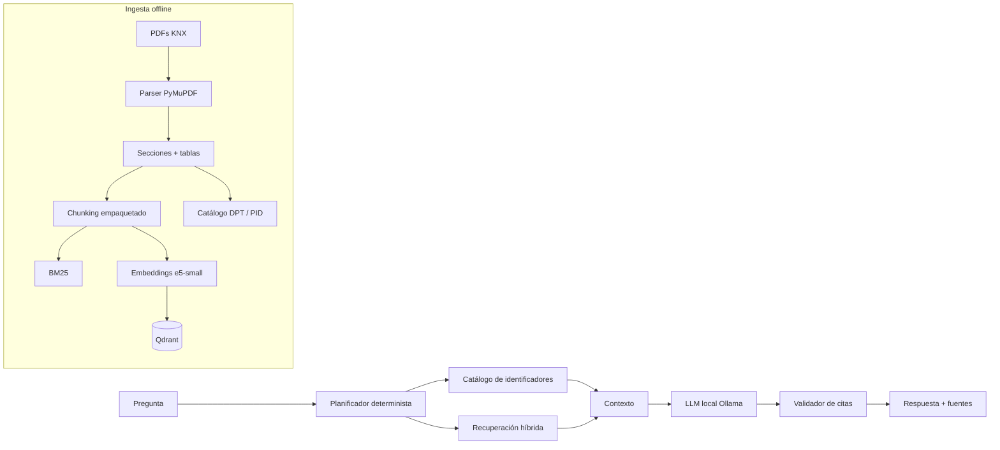

# Arquitectura del KNX RAG Assistant

## Objetivo

Responder preguntas técnicas sobre el estándar KNX v3.0.0 usando únicamente los
PDF locales del corpus, con recuperación híbrida y citas verificables a documento,
sección y página. La demo está pensada para ejecutarse en local: ni el corpus ni
las preguntas salen de la máquina.

## Vista general

## Componentes

| Componente | Archivo | Responsabilidad |
| :--- | :--- | :--- |
| Configuración | `src/config.py` | Variables de entorno, rutas, modelos y límites |
| Manifest | `src/manifest.py` | Inventario de PDFs, SHA-256, volumen, versión y páginas |
| Parser | `src/parse.py` | Texto por líneas, detección de secciones, cabeceras y tablas |
| Chunking | `src/chunk.py` | Empaquetado de secciones cortas, chunks de tabla y metadatos |
| Identificadores | `src/entities.py` | Extracción de DPT, PID, AN y máscaras; filtros y expansión |
| BM25 | `src/bm25.py` | Índice léxico Okapi BM25 sin dependencias externas |
| Embeddings | `src/embeddings.py` | `intfloat/multilingual-e5-small` con *mean pooling* |
| Índice vectorial | `src/index.py` | Colección Qdrant, upsert y búsqueda con filtros |
| Recuperación | `src/retrieve.py` | Fusión RRF de BM25 y densa, filtros y expansión de contexto |
| Reranker | `src/rerank.py` | Cross-encoder opcional sobre los candidatos |
| LLM | `src/llm.py` | Cliente HTTP de Ollama y mock para tests |
| Citas | `src/citations.py` | Contexto etiquetado, parseo y validación de fuentes |
| Respuesta | `src/answer.py` | Prompt, reintento estricto y *fallback* extractivo |
| Agente | `src/agent.py` | State machine determinista con dos intentos de recuperación |
| Evaluación | `src/evaluate.py` | Recall@k, MRR y nDCG@k a nivel de documento |
| API | `app/main.py` | FastAPI, UI local y endpoints de consulta y documentos |

## Flujo de consulta

El agente no usa LangGraph ni multiagentes. Es una máquina de estados explícita y
acotada:

1. **Planificación.** Extrae DPT, PID, AN, volumen y número de documento. Clasifica
   la pregunta (`definition`, `identifier`, `procedure`, `comparison`, `change`,
   `troubleshooting` o `general`). Añade sinónimos bilingües y expansiones de
   acrónimos.
2. **Lookup exacto.** Si hay un DPT o PID, consulta el catálogo extraído de las
   tablas y coloca el chunk correspondiente al principio. AN, máscaras y números
   de documento se usan para expandir la consulta y, cuando aplica, filtrar.
3. **Recuperación híbrida.** Ejecuta BM25 y búsqueda densa con Qdrant, fusiona por
   Reciprocal Rank Fusion (`k=60`) y, si está activo, reordena los mejores
   candidatos con un cross-encoder.
4. **Ensanchamiento.** Si hay menos de dos resultados y había filtros, repite una
   sola vez sin filtros. No hay bucles abiertos.
5. **Expansión de contexto.** Añade chunks vecinos de la misma sección hasta un
   presupuesto de tokens.
6. **Respuesta.** El LLM recibe bloques `[S1]`, `[S2]`, etc. Debe devolver JSON con
   `answer`, `citations` y `abstained`.
7. **Validación.** Se comprueban las citas contra las fuentes recuperadas. Si no
   son válidas, se hace un único reintento estricto. Si el modelo no está
   disponible o sigue fallando, se devuelve un extracto citado del mejor chunk y
   se marca `used_llm=false`.

## Decisiones de diseño

- **Híbrido, no solo embeddings.** DPT y PID se benefician del lookup exacto;
  AN, máscaras y números de documento se benefician de BM25 y de la expansión de
  la consulta. Las paráfrasis se benefician de los embeddings.
- **Secciones empaquetadas.** Un catálogo DPT genera cientos de secciones muy
  cortas. Emitir un vector por sección multiplicaba los chunks por seis y dejaba
  fragmentos sin contexto. El chunking conserva la ruta de sección en el texto,
  pero agrupa secciones consecutivas hasta ~500 palabras.
- **Tablas filtradas.** `find_tables()` detecta también diagramas y fragmentos.
  Solo se conservan tablas con estructura suficiente o con DPT/PID. Las tablas
  alimentan el catálogo exacto y también son recuperables.
- **Qdrant local o servidor.** Sin `QDRANT_URL`, se usa un Qdrant embebido en
  `artifacts/qdrant`. En Docker, la API usa el servicio Qdrant por HTTP. El modo
  local bloquea el directorio: no se puede ingestar y servir con el mismo índice
  al mismo tiempo.
- **Ollama, no API externa.** El modelo por defecto es Qwen2.5 1.5B Instruct
  cuantizado Q4_K_M. El 3B es un modo de calidad opcional; el 7B no es viable en
  este hardware.
- **Sin secretos ni corpus en Git.** `RAG-Agent/`, `artifacts/` y `.env` están
  ignorados. El corpus está protegido por derechos de autor y no se redistribuye.

## Metadatos de un chunk

Cada chunk incluye:

- `chunk_id` estable, `doc_id`, título, volumen, número de volumen y número de documento.
- `section` y `section_path` (pan rallado).
- `page_start` y `page_end`.
- `content_type`: `text`, `table`, `procedure` o `definition`.
- `token_count`, `entities` y SHA-256 del PDF de origen.

Estos metadatos permiten filtrar por volumen o documento, citar con precisión y
auditar de qué archivo sale cada afirmación.

## Limitaciones conocidas

- La detección de secciones es heurística (tamaño de fuente, negrita y patrones).
  Algunos PDFs con maquetación irregular pueden quedar con secciones imprecisas.
- Las tablas se extraen con PyMuPDF; tablas complejas de varias columnas pueden
  perder estructura.
- Los chunks empaquetados pueden abarcar varias secciones. La cita usa la primera
  ruta de sección y el rango de páginas; el texto conserva las rutas incluidas.
- La evaluación actual es de recuperación, no de corrección factual de la
  respuesta. El conjunto de preguntas es una semilla ampliable.
- El *fallback* extractivo evita respuestas inventadas cuando Ollama falla, pero
  no sustituye a una respuesta generada y verificada.
- La calidad del LLM de 1.5B es limitada; las citas y la abstención son la red de
  seguridad, no una garantía de razonamiento complejo.
