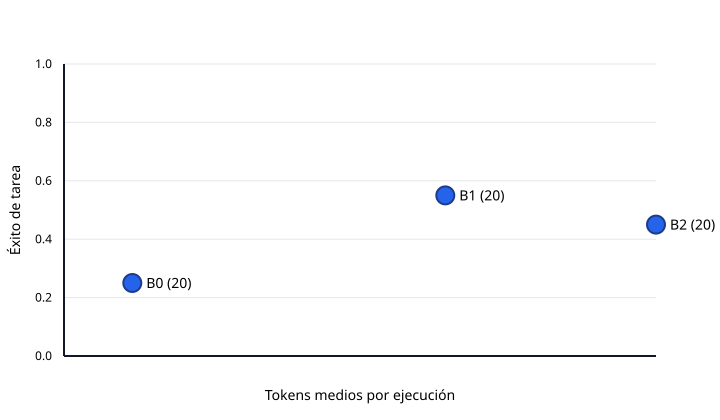

# Evaluación eval-full-20261024

Generado: 2026-10-25T10:03:33.137818+00:00

Registros: 31

Este resumen agrega ejecuciones reales; la metodología, la revisión manual y las limitaciones están en `docs/evaluation.md`.

## Resultados globales

| Sistema | Éxito tarea | Score juez | Cobertura | Precisión citas | Validez citas | Recall fuentes | Soporte claims | Abstención | Llamadas | Tokens | Latencia p50 | Latencia p95 |
| :--- | :---: | :---: | :---: | :---: | :---: | :---: | :---: | :---: | :---: | :---: | :---: | :---: |
| B0 · agente único (20) | 0.25 | 1.20 | 0.56 | 0.83 | 1 | 0.89 | 1 | 1 | 2 | 2143 | 58.5 | 59.8 |
| B1 · pipeline fijo (11) | 0.36 | 1.36 | 0.52 | 0.81 | 1 | 0.91 | 1 | — | 9.64 | 13105.64 | 359.4 | 360.9 |

## Éxito de tarea por categoría

| Categoría | B0 · agente único | B1 · pipeline fijo |
| :--- | :---: | :---: |
| factual | 0.20 | 0.20 |
| comparison | 0.20 | 0.40 |
| multi_hop | 0 | 1 |
| unanswerable | 0.60 | — |

El número entre paréntesis de la tabla global es el total de registros por sistema; una categoría con pocos registros (por ejemplo, n=1) no es comparable con una de n=5.

## Calidad frente a coste

El gráfico usa el éxito de tarea medio y los tokens medios por ejecución.

