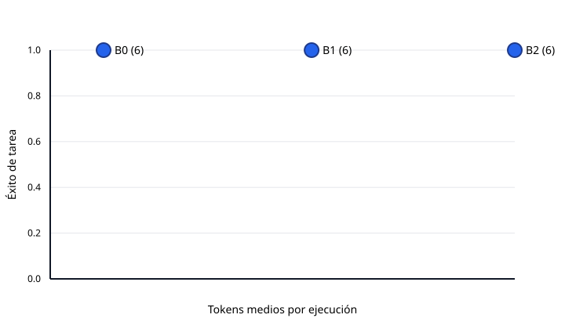

# Evaluación robust-20261029

Generado: 2026-10-29T11:09:49.784391+00:00

Registros: 18

Este resumen agrega ejecuciones reales; la metodología, la revisión manual y las limitaciones están en `docs/evaluation.md`.

## Resultados globales

| Sistema | Éxito tarea | Score juez | Cobertura | Precisión citas | Validez citas | Recall fuentes | Soporte claims | Abstención | Llamadas | Tokens | Latencia p50 | Latencia p95 |
| :--- | :---: | :---: | :---: | :---: | :---: | :---: | :---: | :---: | :---: | :---: | :---: | :---: |
| B0 · agente único (6) | 1 | 2 | 0.44 | 1 | 1 | 1 | 1 | 1 | 2 | 1767.67 | 56.8 | 58.3 |
| B1 · pipeline fijo (6) | 1 | 2 | 1 | 0.41 | 1 | 1 | 1 | 1 | 7.33 | 8658.67 | 243.3 | 302.2 |
| B2 · equipo completo (6) | 1 | 2 | 0.78 | 0.38 | 1 | 1 | 1 | 0.67 | 9 | 15387.83 | 360.9 | 422.8 |

## Éxito de tarea por categoría

| Categoría | B0 · agente único | B1 · pipeline fijo | B2 · equipo completo |
| :--- | :---: | :---: | :---: |
| factual | 1 | 1 | 1 |
| unanswerable | 1 | 1 | 1 |

El número entre paréntesis de la tabla global es el total de registros por sistema; las categorías usan solo sus propios registros, así que un n distinto no es comparable.

## Calidad frente a coste

El gráfico usa el éxito de tarea medio y los tokens medios por ejecución.

