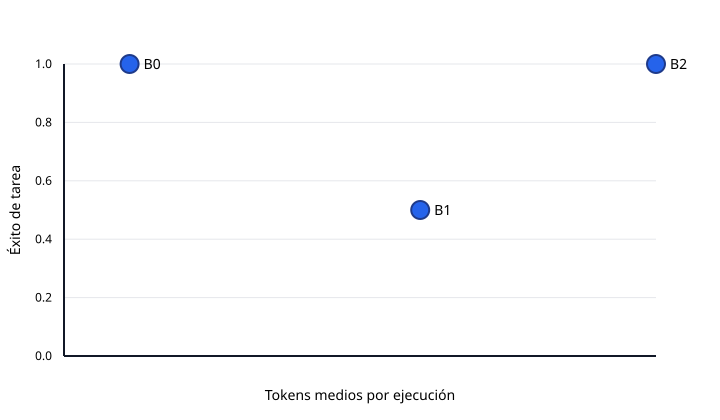

# Evaluación smoke-20261023b

Generado: 2026-10-23T10:11:10.985158+00:00

Registros: 6

Este resumen agrega ejecuciones reales; la metodología, la revisión manual y las limitaciones están en `docs/evaluation.md`.

## Resultados globales

| Sistema | Éxito tarea | Score juez | Cobertura | Precisión citas | Validez citas | Recall fuentes | Soporte claims | Abstención | Llamadas | Tokens | Latencia p50 | Latencia p95 |
| :--- | :---: | :---: | :---: | :---: | :---: | :---: | :---: | :---: | :---: | :---: | :---: | :---: |
| B0 · agente único | 1 | 2 | 1 | 0.67 | 1 | 1 | 1 | 1 | 2 | 1786 | 1.8 | 56.3 |
| B1 · pipeline fijo | 0.50 | 1.50 | 1 | 0.40 | 1 | 1 | 1 | 1 | 8 | 9703 | 241.9 | 302.0 |
| B2 · equipo completo | 1 | 2 | 1 | 0.25 | 1 | 1 | 1 | 1 | 10 | 16128.50 | 363.6 | 419.8 |

## Éxito de tarea por categoría

| Categoría | B0 · agente único | B1 · pipeline fijo | B2 · equipo completo |
| :--- | :---: | :---: | :---: |
| factual | 1 | 0 | 1 |
| unanswerable | 1 | 1 | 1 |

## Calidad frente a coste

El gráfico usa el éxito de tarea medio y los tokens medios por ejecución.

