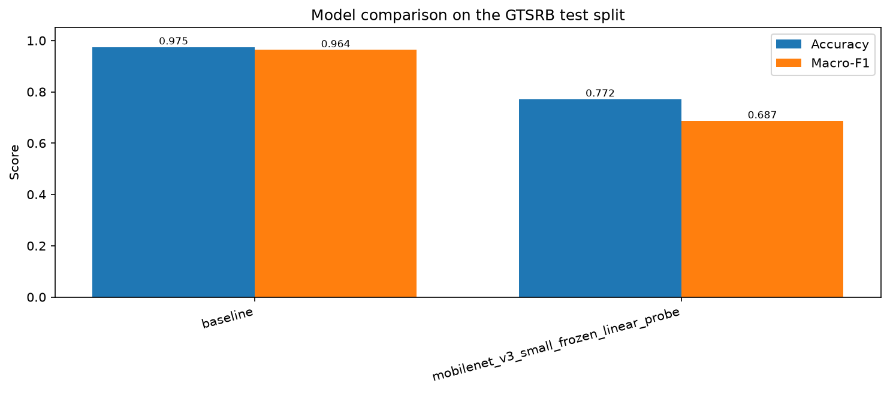
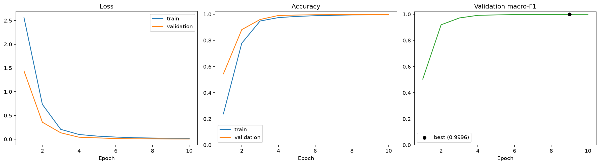
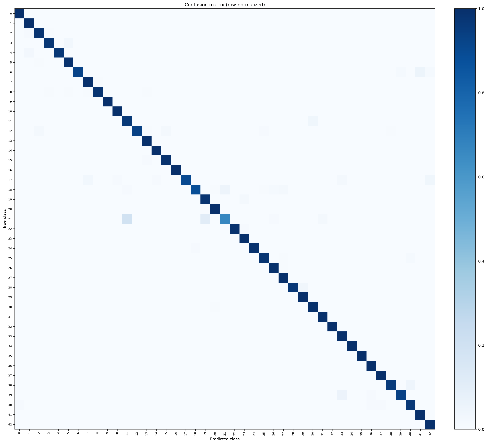
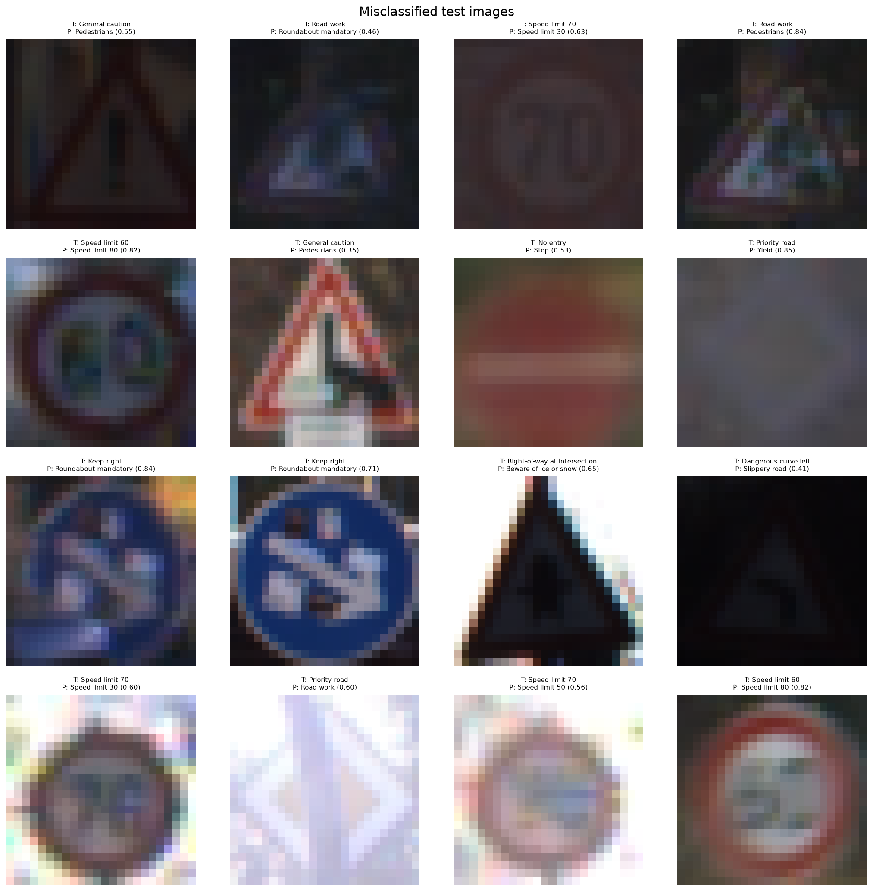
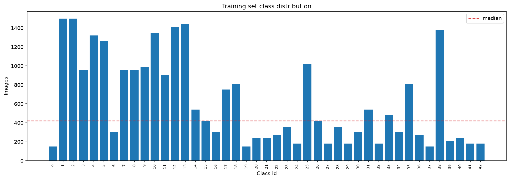
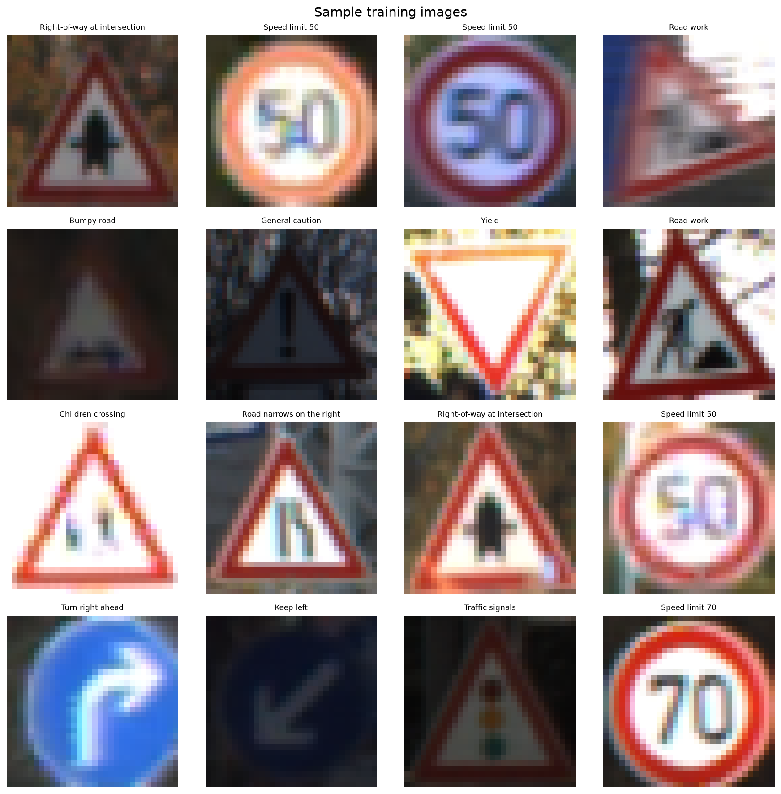

# Clasificación de señales de tráfico (GTSRB)

Clasificador de 43 tipos de señales de tráfico con PyTorch. El proyecto compara una
CNN entrenada desde cero con un *linear probe* sobre características de MobileNetV3
preentrenada en ImageNet, y reporta métricas por clase, matriz de confusión y análisis
de errores.

## Resultados

Métricas sobre el split de test oficial (12.630 imágenes), con el umbral de decisión
estándar (mayor probabilidad):

| Modelo | Accuracy | Macro-F1 | Weighted-F1 | Parámetros entrenables |
| :--- | ---: | ---: | ---: | ---: |
| SmallCNN (desde cero, 24×24) | **0,9747** | **0,9636** | **0,9747** | 293.003 |
| MobileNetV3-Small congelada + regresión logística (96×96) | 0,7717 | 0,6868 | 0,7708 | 24.811 |

La CNN entrenada desde cero es claramente superior. El *linear probe* alcanzó un
macro-F1 de 0,96 en la validación aleatoria, pero cayó a 0,69 en el test oficial: la
validación comparte secuencias de vídeo casi duplicadas con train, mientras que el test
contiene condiciones nuevas. Es una comparación útil porque muestra el límite de usar
características de ImageNet congeladas en un dominio tan específico.









El análisis de confusiones más frecuentes está en
[`results/baseline/test/top_confusions.csv`](results/baseline/test/top_confusions.csv).
Los errores se concentran en clases visualmente próximas: límites de velocidad
consecutivos (30/50/80), señales de dirección (mantener izquierda/derecha) y curvas
peligrosas. La clase con peor recall es “Double curve” (66,7%); el resto supera el 88%.

## Dataset

- **GTSRB** (*German Traffic Sign Recognition Benchmark*): 43 clases.
- **26.640** imágenes de entrenamiento y **12.630** de test.
- Las imágenes originales tienen tamaños y recortes variables; se usa la región de
  interés (`Roi.X1`, `Roi.Y1`, `Roi.X2`, `Roi.Y2`) de las anotaciones oficiales.
- Split de entrenamiento: **85% train / 15% validation**, estratificado por clase y con
  semilla fija (`42`). El test oficial no se toca durante el desarrollo.
- Los datos **no se versionan**. `scripts/download_data.py` los descarga con torchvision
  y verifica los conteos.

Distribución de clases: entre 150 y 1.500 imágenes por clase; por eso se usan pesos
inversos a la frecuencia en la función de pérdida.





## Enfoque

1. **Preprocesado:** recorte del ROI y redimensionado a 24×24 (CNN) o 96×96 (transfer).
   El ROI nativo mide ~25×25, así que 24×24 apenas pierde información y mantiene el
   entrenamiento viable en CPU.
2. **Augmentación (solo train):** rotación y traslación suaves, cambio de escala y
   *color jitter*. Sin *horizontal flip*: muchas señales no son simétricas.
3. **SmallCNN:** tres bloques convolucionales (32/64/128 canales) con BatchNorm,
   max-pooling, dropout y una capa lineal final. 293.003 parámetros.
4. **Transfer learning:** MobileNetV3-Small preentrenada en ImageNet, congelada, usada
   como extractor de características (576 dimensiones) y un clasificador lineal
   (regresión logística multinomial) entrenado en PyTorch. Se prueban tres
   combinaciones de `lr` y `weight_decay` en validación y se conserva la mejor.
5. **Evaluación:** accuracy, macro-F1, F1 ponderado, precisión/recall/F1 por clase,
   matriz de confusión normalizada y las confusiones más frecuentes.

## Cómo ejecutar

Requisitos: Python 3.12 y [uv](https://docs.astral.sh/uv/).

```bash
cd traffic-signs
uv venv --python 3.12
uv pip install -r requirements-dev.txt

# Descarga y verifica el dataset (no se sube a Git)
uv run python scripts/download_data.py

# Entrena la CNN desde cero
uv run python -m src.train --config configs/baseline.yaml

# Evalúa el checkpoint en el test oficial
uv run python -m src.evaluate --checkpoint checkpoints/baseline.pt --split test

# Baseline de transferencia (extrae características y entrena la regresión)
uv run python -m src.linear_probe --config configs/mobilenet_v3_small.yaml

# Tests y lint
uv run pytest -q
uv run ruff check src tests scripts
```

Los artefactos se guardan en `results/<run>/` (curvas, historial, métricas,
matriz de confusión) y `results/<run>/test/` (evaluación final). Los checkpoints van a
`checkpoints/`, que está ignorado por Git.

## Estructura

```
traffic-signs/
├── configs/                  # baseline.yaml, mobilenet_v3_small.yaml
├── scripts/download_data.py  # descarga y validación del dataset
├── src/
│   ├── data.py               # dataset, ROI, transforms y split
│   ├── model.py              # SmallCNN y modelos de torchvision
│   ├── train.py              # entrenamiento y validación
│   ├── evaluate.py           # métricas y artefactos de test
│   ├── linear_probe.py       # transfer learning con características congeladas
│   ├── metrics.py            # accuracy, F1, matriz de confusión
│   └── viz.py                # curvas, muestras, errores
└── tests/                    # dataset, métricas y modelos
```

## Limitaciones

- El *linear probe* congela el backbone: no se hace fine-tuning completo, así que no
  representa el techo de MobileNetV3 en este dataset. Es una cota inferior deliberada.
- El split de validación es aleatorio y comparte secuencias de vídeo con train, por lo
  que sobreestima el rendimiento. El test oficial es la métrica que se reporta; un
  split agrupado por secuencia sería la siguiente mejora metodológica.
- Sin *test-time augmentation* ni ensamblados.
- GTSRB es un benchmark curado; las condiciones reales (iluminación, oclusión, ángulos)
  son más difíciles. El propio test ya muestra imágenes oscuras y borrosas.
- El entrenamiento se ejecutó en CPU (Intel i5-7200U), por lo que no se exploraron
  arquitecturas más grandes ni fine-tuning completo.

## Referencias

- Stallkamp, J., Schlipsing, M., Salmen, J., & Igel, C. (2012). *Man vs. computer:
  Benchmarking machine learning algorithms for traffic sign recognition*. Neural Networks.
- [torchvision GTSRB](https://pytorch.org/vision/stable/generated/torchvision.datasets.GTSRB.html)
